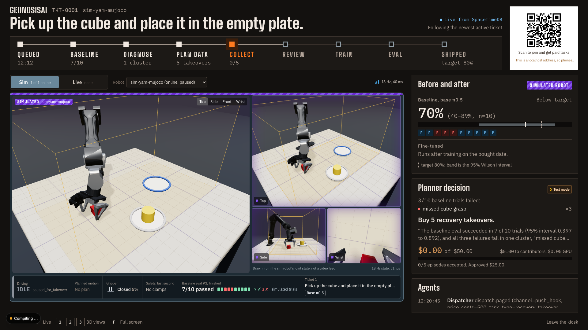
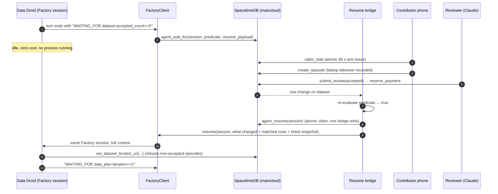
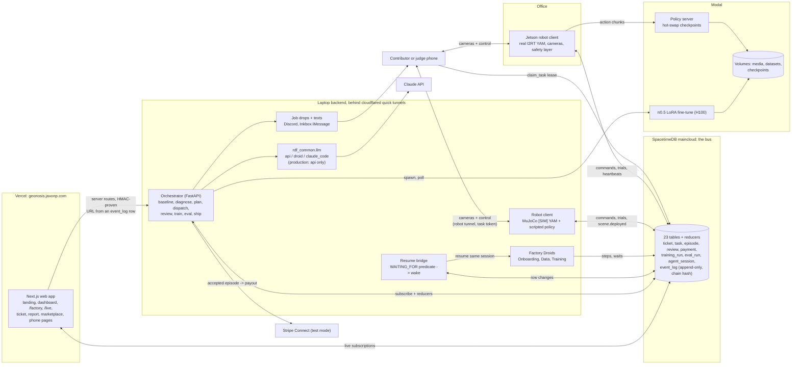

<div align="center">

# GEONOSISAI

### Plug in your robot, tell it the job, and the factory gets it deployed.

Agents run the whole robot deployment loop: eval, diagnose, buy the right data from people on their phones, fine-tune, re-eval, ship.

[**Live site**](https://geonosis.jaxonp.com) · [Devpost write-up](docs/submission/devpost-paste.md) · [Architecture](docs/submission/architecture.md) · [Pitch](docs/submission/pitch.md)


<sub>Built at Cal Hacks 13.0</sub>

<br/>



<sub>The <code>/live</code> view on the MuJoCo sim YAM: the baseline went 7/10, Claude found one failure cluster ("missed cube grasp"), and the planner decided to buy 5 recovery takeovers.</sub>

</div>

---

## Why

Getting a robot to actually *do* something is painful. You run the policy, watch it fail, guess why, collect more demos, retrain and run the eval again, with a lot of manual steps (and manual mistakes) in between.

Robot data is expensive, and so is the infrastructure to collect it. Data companies aren't set up to collect data for *your* task on *your* robot. But someone with a phone will give you a few good episodes for $5. Scale that out and you have a usable dataset.

So agents should run the loop, and pay people for the one thing agents can't do: touch the physical world.

## How it works

You file a ticket: *"Put the cube in the bin, 80% reliable, $50 budget."* It moves down the line:

| | Station | What happens |
|:-:|---|---|
| 1 | **Baseline** | The robot runs the task on its current policy. Every trial is recorded. |
| 2 | **Diagnose** | Claude groups the failed trials by *why* they failed, from notes, timings and camera frames. |
| 3 | **Plan data** | The planner picks **recovery takeovers** (a person takes over the paused robot mid-failure) or **clean demos**, and how many. It must quote a failure cluster. A human approves the spend. |
| 4 | **Collect** | Paid tasks go out on Discord and by text ("Reply YES"). Contributors claim on their phones, watch the cameras, drive the arm in the browser and hand back. |
| 5 | **Review** | Deterministic checks plus a Claude vision review. Accepted episodes are paid (Stripe test mode). |
| 6 | **Train** | π0.5 LoRA fine-tune on an H100 on Modal, from the accepted episodes in LeRobot format. |
| 7 | **Eval → Ship** | The new checkpoint runs the same eval. It ships with a report if it clears the target. If not, the line buys more data. |

Every rate shows its Wilson 95% interval (at 10/10 the lower bound is only 0.72). Every decision, payout and wake-up lands in an append-only, hash-chained event log.

## Highlights

- **Agents that sleep on the database.** A Factory Droid ends its turn with `WAITING_FOR dataset:accepted_count>=5` and idles for free. A resume bridge re-checks that predicate on every SpacetimeDB row change and wakes the *same* session. In testing, an accepted review woke a parked droid in 597 ms.
- **SpacetimeDB is the bus.** Services, agents, robots and phones all share 23 tables. Reducers keep the risky actions atomic: one arm-control lease per robot, a budget check on every payout, an event log nothing can edit.
- **Real arm and twin sim behind one interface.** The I2RT YAM on an NVIDIA Jetson and a MuJoCo model of the same arm run behind the same safety layer (joint limits, velocity caps, workspace box, watchdog, soft e-stop). Sim and real numbers are never pooled.
- **Remote π0.5 at control rate.** The policy server on Modal hot-swaps checkpoints. The robot runs 50-step action chunks asynchronously and crossfades between them to hide a ~157 ms round trip.
- **Claude everywhere a human used to make a judgment call:** per-ticket 3D scenes, failure clustering, the data plan, episode review and real-arm trial verdicts from the live cameras.
- **Honest labels.** Anything simulated or stubbed says `[SIM]`, `[STUB]` or `[SEEDED]` wherever it shows up.

## Factory × SpacetimeDB: agents that live inside the database

The core idea: **SpacetimeDB is the factory's shared memory and nervous system, and Factory Droids are the workers on the line.** Droids never poll and never hold a process open while they wait. They write to the database, say what row change they're waiting for, and go to sleep. The database wakes them.



### SpacetimeDB: the bus and the rulebook

Everything (the orchestrator, three kinds of Factory Droids, the Jetson robot client, the MuJoCo sim, the web app, every contributor's phone and the Claude MCP connector) reads and writes **one SpacetimeDB database on maincloud** (`robo-factory-a706j`).

- **23 tables** make up the factory's whole state: `ticket`, `eval_run`, `eval_trial`, `failure_cluster`, `data_plan`, `task`, `episode`, `review`, `payment`, `dataset`, `training_run`, `robot`, `robot_command`, `agent_session`, `event_log`, and more.
- **~55 reducers** are the only way to change that state, and the safety rules live inside them, not in prompts or app code:
  - `claim_task`: one arm-control lease per robot, atomic, 60 s, renewed by `heartbeat_claim`. Two phones can never drive the same arm.
  - `approve_spend` and `reserve_payment`: no payout can exceed the human-approved budget.
  - `set_dataset_lerobot_uri`: a droid can point training at a dataset only if every episode in it was accepted by review.
  - `agent_wait_for` and `agent_resume`: park a droid, then claim its wake-up atomically, so exactly one bridge resumes it.
  - `append_event`: callable only by registered service identities. The log has no update or delete path, and it carries a chain hash so you can prove it wasn't edited.
- **Service identities.** Each actor (orchestrator, factory, robot, mcp) has its own SpacetimeDB identity and role. Reducers check the role (`requireRole`), so a droid can't, say, accept its own episodes.
- **Subscriptions drive everything live.** The factory floor, ticket pages, agents panel and `/live` view all render live from SpacetimeDB subscriptions. The orchestrator subscribes over a raw WebSocket client we wrote (there's no maintained Python SDK for 2.x). The robot receives `robot_command` rows, acks them and writes `eval_trial` and heartbeats back.
- **Logic inside the module.** A scheduled reducer sweeps stale contributor presence every 30 s, and `expire_task_leases` frees arm leases whose holder stopped heartbeating.
- **It even does service discovery.** The laptop backend publishes its tunnel URL as an `event_log` row, and Vercel and the Jetson find it there (with an HMAC proof).

### Factory Droids: the engineers on the line

Three Factory Droid roles do the work a robotics engineer would otherwise do between steps. Each one is a real Factory session driven through `droid-sdk` (`services/factory/`), with its status and every step mirrored into SpacetimeDB:

| Droid | Wakes on | Does |
|---|---|---|
| **Onboarding** | a new ticket whose robot isn't set up yet | Writes or validates the robot's adapter config, runs the adapter/camera/safety/IK checks, fixes what fails, writes the success check and reset routine. On real hardware it parks until a human confirms the motion checks (`WAITING_FOR event_log:onboarding.hil_confirmed`). |
| **Data** | `dataset:accepted_count>=N` | Validates the accepted episodes, cuts the failure frames before each takeover, assembles the LeRobot v2.1 dataset, verifies it, writes a dataset card and publishes it. Then it sleeps until the next iteration's data plan. |
| **Training** | the dataset is ready, then `training_run.status` changes | Sanity-checks the data before any GPU is spent, picks hyperparameters and writes down why, queues the H100 run and sleeps. On an OOM it wakes, halves the batch and retries once. On success it reads the loss curve and writes a training note. |

**How they're wired:**
- **The droid contract.** Every turn ends with exactly one line: `DONE` or `WAITING_FOR <table>:<field><op><value>`. The predicate can also be JSON with `all`/`any`, aggregates (`count`, `sum`, …) and a timeout. `FactoryClient` parses that line and calls `agent_wait_for`.
- **The resume bridge** (`services/orchestrator`) re-evaluates every parked predicate on each SpacetimeDB row change. When one turns true, it claims the wake-up with `agent_resume` and sends the droid what changed, the matching rows, its saved `resume_payload` and a ticket snapshot. The resume goes to the **same Factory session** (protocol A). If that session is gone, a fresh one is seeded from the saved payload (protocol B). A wait that times out wakes the droid with `TIMED OUT` so it can decide what to do.
- **Bounded by design.** Droids run with `autonomy=off`, a turn cap, write access only to their own work directory, and one allow-listed tool. The tool only talks to the database named in the droid's context, so a droid can't wander into prod. We found that droid-sdk's default autonomy skips the permission handler, which is why `off` is enforced.
- **Visible on the floor.** Every droid step is an `agent_session` update plus a `droid.*` row in `event_log`. The `/factory` page shows droids riding to their station, sleeping with their `WAITING_FOR` predicate on screen, and "woke on `dataset:accepted_count`" when the database wakes them.

**Measured:** in the end-to-end proof, an accepted review woke a parked Data Droid in **597 ms**, on the same Factory session. The Training Droid chained two waits on one session (queued, forced OOM, woke, halved the batch, re-queued, finished, wrote the loss note) in 3 turns.

## Architecture



- **Discovery.** The backend runs on a laptop behind quick tunnels whose URLs change on every start. `make demo-hybrid` publishes the current URL as an `orchestrator.endpoint` row in SpacetimeDB. Vercel reads it and checks an HMAC proof before trusting it. No backend key is on Vercel.
- **Scenes.** Claude writes a scene spec per ticket. The sim robot hot-swaps to it, and the browser's three.js twin draws the same JSON.

More detail in [docs/submission/architecture.md](docs/submission/architecture.md).

## What's real and what's simulated

| Area | Status |
|---|---|
| SpacetimeDB, orchestrator, Claude diagnosis / planning / review | **Real**, on maincloud with real Claude calls |
| Factory Droids | **Real** Factory sessions, woken by SpacetimeDB writes |
| π0.5 LoRA fine-tune + policy server | **Real** on Modal H100, including a run on public real-YAM data |
| Real I2RT YAM on a Jetson | **Real**: phone teleop, recording, guarded policy rollouts, Claude trial verdicts |
| MuJoCo YAM policy | **[SIM]** scripted IK stand-in, *not* π0.5. Its before/after gap is a designed calibration, not learning. |
| Training in `make demo` | **[STUB]** by default; `--real-modal` runs real H100 training |
| Payments | Stripe Connect **test mode**. No real money moves. |

## Quickstart

Needs Node 20+, pnpm 11, [uv](https://docs.astral.sh/uv/), the `spacetime` CLI and make.

```sh
cp .env.example .env && make install   # fill in keys; `make env-check` shows which are set, never values
make demo                              # the whole factory on this laptop, on the MuJoCo [SIM] YAM
```

Then open **http://localhost:3737**. `make demo` boots a throwaway local SpacetimeDB, the orchestrator, the sim robot, the `[SIM]` policy server and the web app. Nothing touches maincloud. Add `ARGS="--real-modal"` for real H100 training and `LLM=claude_code` to run Claude calls on your local Claude Code login. `make demo-down` stops it.

<details>
<summary><b>Live setup (Vercel + laptop backend + maincloud)</b></summary>

```sh
make demo-maincloud ARGS="--orch-port 8028 --web-port 3737"
make demo-hybrid ARGS="--stack attach --orch-url http://127.0.0.1:8028 --stream-port 8791 \
  --robot-name sim-yam-mujoco --stdb-url https://maincloud.spacetimedb.com --db robo-factory-a706j"
```

Check it with `https://geonosis.jaxonp.com/api/tdm110/backend`, which should return `{"ok": true}`. One-time setup is in [docs/MORNING.md](docs/MORNING.md), "Hybrid deploy".

Other entry points: `make test-loop` (full loop on a fake robot and a throwaway database), `make demo-public` (the whole demo on phones through one tunnel, behind an access code), `make dev` (Docker Compose).

</details>

## Pages

| Page | What |
|---|---|
| `/` | Landing page with live numbers |
| `/factory` | The factory floor: each ticket is a lane of agent stations; droids sleep and wake on database updates |
| `/live` | Projector view: robot, the line, before/after, planner decision, join QR |
| `/tickets/[id]` | Ticket status, 3D scene, evals with Wilson CI, decision trail, tasks, payouts, episodes |
| `/tickets/[id]/report` | Printable report: what was bought, why, cost, before vs after |
| `/marketplace`, `/join`, `/earnings` | Paid tasks, contributor sign-up, test-mode earnings |
| `/teleop/[taskId]`, `/practice` | Drive the arm from a phone; practise on a browser copy first |
| `/agents`, `/events` | Droid sessions and wake-ups; the append-only event log with its chain-hash seal |
| `/dashboard` | Operator dashboard (login at `/ops/login`) |

## Repo layout

| Path | What |
|---|---|
| `spacetime/` | SpacetimeDB module: schema, reducers, subscriptions |
| `apps/web/` | Next.js web app: dashboard, factory floor, phone pages |
| `apps/mcp/` | Claude connector (remote MCP server) |
| `services/orchestrator/` | The line: baseline, diagnose, plan, dispatch, review, train, eval, ship |
| `services/factory/` | Factory Droid sessions, wait-for protocol, resume bridge |
| `services/training/` | LeRobot conversion, π0.5 fine-tune, policy server (Modal) |
| `services/robot-client/` | YAM + MuJoCo adapters, safety layer, cameras, recorder, takeover, evals |
| `services/payments/` | Stripe test-mode payouts |

## Built with

Claude API · Claude Code · Factory Droid SDK · SpacetimeDB · Modal · openpi π0.5 · LeRobot · MuJoCo · I2RT YAM · NVIDIA Jetson · Python · FastAPI · TypeScript · Next.js · React · three.js · Tailwind CSS · Vercel · cloudflared · Stripe Connect · Discord · Inkbox iMessage · MCP

<details>
<summary><b>Developer reference: setup, Docker, CI</b></summary>

### Setup

```sh
cp .env.example .env     # fill in keys; .env is gitignored
make env-check           # shows which keys are set, never their values
make install             # pnpm install + uv sync in each Python service
make dev                 # docker compose up; `make dev-host` runs on the host instead
```

### Docker (`docker-compose.yml`)

| Command | Starts |
|---|---|
| `make dev` | `orchestrator` (:8000), `web` (:3737), `mcp` (:3002), on **Maincloud** via `SPACETIME_HOST` |
| `make dev-local` | the same plus a local `spacetimedb` container (:3300); then `make spacetime-publish` |
| `make dev-minio` | `make dev` plus `minio` (:9000, console :9001) and an `episodes` bucket |
| `make dev-down` | stops everything, all profiles |

Port clashes: set `ORCHESTRATOR_PORT`, `WEB_PORT`, `MCP_PORT`, `SPACETIME_LOCAL_PORT`, `MINIO_PORT` or `MINIO_CONSOLE_PORT`. `make seed` seeds a **local** SpacetimeDB only.

### CI

`make ci` runs what `.github/workflows/ci.yml` runs: pytest per Python service, workspace typechecks and tests, the SpacetimeDB module typecheck, ruff and `scripts/verify_event_log.py static`, with fake settings only. One step at a time: `make ci-py SERVICE=orchestrator`, `make ci-ts`, `make ci-lint`.

### More docs

[CONTEXT.md](CONTEXT.md) (build spec) · [docs/decisions.md](docs/decisions.md) · [docs/MORNING.md](docs/MORNING.md) · [docs/real-arm-safety.md](docs/real-arm-safety.md) · [services/factory/README.md](services/factory/README.md) · [judge Q&A](docs/submission/qa.md)

</details>
