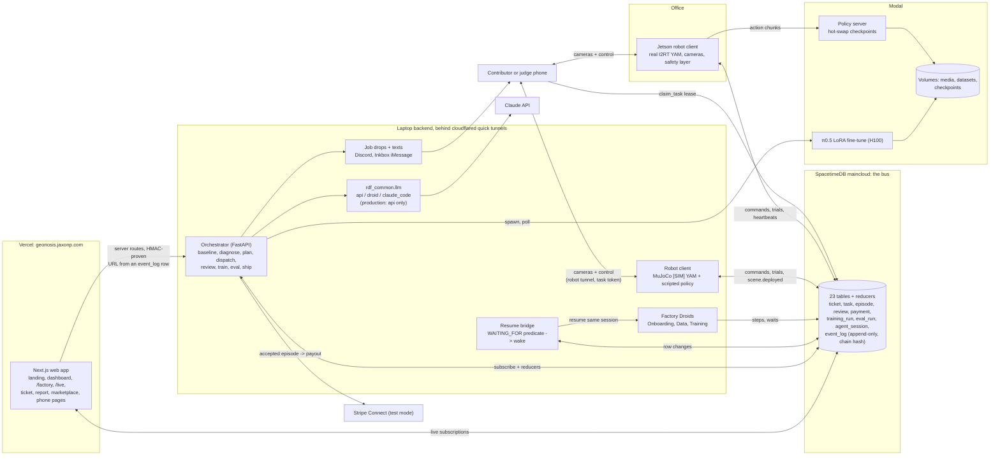

# GeonosisAI (Robot Deployment Factory)

**Plug in your robot, tell it the job, and the factory gets it deployed.** Built at Cal Hacks 13.0.

**Live:** https://geonosis.jaxonp.com

You file a ticket for a robot: "Put the cube in the bin, 80% reliable, $50 budget." The foundry runs a 10-trial
baseline, has Claude group the failures, and decides *which kind of data* fixes them: recovery takeovers (a person
takes over the paused robot mid-failure) or clean demos. It buys exactly that data from contributors on their phones,
reviews and pays for each episode (Stripe test mode), fine-tunes π0.5 with LoRA on a Modal H100, runs the same eval on
the new checkpoint, and ships it with a report. SpacetimeDB is the bus every part shares. Factory Droids do the
engineering and sleep on database predicates until a row changes.

What is real and what is simulated:
- **Real:** SpacetimeDB on maincloud, the orchestrator, Claude diagnosis, planning and review, Factory Droid sessions
  woken by database writes, π0.5 LoRA fine-tunes on H100 (including one on public real-YAM data), the policy server,
  the Vercel site, Discord job drops.
- **Simulated:** the MuJoCo YAM. Its policy is a scripted IK stand-in labelled `[SIM]`, **not π0.5**. Its before/after
  gap is a designed calibration, not learning.
- **Stubbed by default in `make demo`:** training (`[STUB] no GPU`; `--real-modal` for real H100 runs). Rehearsal
  evals can be `[SEEDED] not run` (`--seed-evals`, sim robots only).
- **Real arm:** `[TODO after real run: baseline k/10 -> after k/10 on the YAM]`

Submission: [Devpost write-up](docs/submission/devpost.md) · [pitch](docs/submission/pitch.md) ·
[judge Q&A](docs/submission/qa.md) · [demo video plan](docs/submission/demo-video.md).

## 60-second quickstart

Needs Node 20+, pnpm 11, [uv](https://docs.astral.sh/uv/), the `spacetime` CLI and make.

```sh
cp .env.example .env && make install   # fill in keys; make env-check shows which are set, never values
make demo                              # everything on this laptop, on the MuJoCo [SIM] YAM
```

`make demo` boots a throwaway local SpacetimeDB, the full orchestrator, the MuJoCo sim robot, the `[SIM]` policy
server and the web app on http://localhost:3737. Nothing touches maincloud. Training is a stub unless you pass
`ARGS="--real-modal"`. Add `LLM=claude_code` to run every Claude call on your local Claude Code login instead of the
API. `make demo-down` stops it.

The live setup (Vercel site, backend on this laptop, maincloud):

```sh
make demo-maincloud ARGS="--orch-port 8028 --web-port 3737"
make demo-hybrid ARGS="--stack attach --orch-url http://127.0.0.1:8028 --stream-port 8791 \
  --robot-name sim-yam-mujoco --stdb-url https://maincloud.spacetimedb.com --db robo-factory-a706j"
```

The first command runs the real stack against maincloud. The second opens two cloudflared quick tunnels (orchestrator
and robot) and publishes their URLs to SpacetimeDB, where the Vercel site finds them. Check it with
`https://geonosis.jaxonp.com/api/tdm110/backend`, which should return `{"ok": true}`. One-time setup (Vercel env,
domain, secrets) is in [docs/MORNING.md](docs/MORNING.md), "Hybrid deploy".

Other entry points: `make test-loop` (full loop on a fake robot and a throwaway database), `make demo-public` (the
whole demo on phones through one tunnel, no Vercel), `make dev` (Docker Compose).

## Architecture



- **Discovery:** `make demo-hybrid` writes an `orchestrator.endpoint` row to `event_log`. Vercel reads the newest one,
  checks `GET <url>/_rdf/proof` against an HMAC of a nonce, and only then sends that URL the shared edge secret. No
  backend key (Anthropic, Modal, Factory, Stripe, SpacetimeDB owner token) is on Vercel.
- **Robot mode is per ticket:** a ticket runs on its robot, sim or real, and the operator can switch it. Sim and real
  numbers are never pooled.
- **Scenes:** Claude writes a scene spec per ticket. The sim robot hot-swaps to it, and the three.js twin draws the
  same JSON from top, side and wrist cameras.

More detail: [docs/submission/architecture.md](docs/submission/architecture.md).

## What ran on its own

Every actor writes to `event_log` through one path. Rows can be appended, never edited or deleted.
`python scripts/verify_event_log.py` prints the row count, range, gaps and the `rdf-evlog-chain-v1` hash, which matches
the seal on `/events`. `--expect N:HASH` proves the first N rows are unchanged. `GET /tickets/{id}/decision` joins the
eval, clusters, planner reasoning, approval, tasks, episodes, training run and after-eval by id, and flags any owner
action in the chain.

Real run: `[TODO after real run: row count and hash from scripts/verify_event_log.py, the ticket id, and which steps ran unattended]`

## Key pages

Web on `http://localhost:3737` locally, or https://geonosis.jaxonp.com.

| Page | What |
|---|---|
| `/` | Public landing page with live numbers |
| `/dashboard` | Operator dashboard (login at `/ops/login`) |
| `/factory` | The factory floor: every active ticket as a lane of agent stations; droids sleep and wake on SpacetimeDB updates |
| `/live` | Projector view: robot, the line, before/after with intervals, planner decision, agent wake-ups, join QR |
| `/tickets/new`, `/tickets/[id]` | Create a ticket; live status, scene, evals with Wilson CI, decision trail, tasks, payouts, episodes, training runs |
| `/tickets/[id]/report` | Printable report: what was bought, why, cost, before vs after |
| `/agents` | Factory Droid sessions, steps and resume-bridge wake-ups |
| `/events` | Append-only event log with the chain-hash seal |
| `/marketplace`, `/join`, `/earnings` | Paid tasks (atomic claim), contributor join and job-text opt-in, test-mode earnings |
| `/teleop/[taskId]`, `/reset/[taskId]`, `/practice` | Phone pages: drive the arm behind the task lease, do a paid reset, practise on a browser copy of the robot |
| `/robots/[id]` | Robot view: 3D twin, cameras, HUD, command queue, soft e-stop |
| `/ops/drops`, `/ops/settings` | Job drops and texts by channel; LLM backend switch (hidden in production) |

Every Claude call goes through `rdf_common.llm`, switched by `RDF_LLM_BACKEND` = `api` (default) | `droid` |
`claude_code`. Pick it per command (`make test-loop DRIVER=orchestrator LLM=claude_code`), in `.env`, or live from
`/ops/settings`. Production and cloud deploys are locked to `api`. Decisions record which backend and model made them.

## Phone access (`make demo-public`)

`make demo-public` makes the local demo reachable from phones over HTTPS, without putting the laptop on the venue
Wi-Fi. It runs `make demo` plus a production web build behind one local edge (`scripts/demo/public_guard.py`) and
one cloudflared tunnel. It prints the `/join` link, a terminal QR code and an **access code**, which phones enter once.
`make demo-public-down` stops it, tunnel first.

- **Quick tunnel (default):** no account needed, but you get a new `*.trycloudflare.com` URL on every run.
- **Named tunnel:** a stable `https://app.<domain>`. One-time setup: `cloudflared tunnel login`, then `cloudflared tunnel create rdf-demo`, then `cloudflared tunnel route dns rdf-demo app.<domain>`. After that, run `RDF_PUBLIC_DOMAIN=<domain> make demo-public`.
- **What's protected:**
  - The access code covers pages, the API and the SpacetimeDB socket. It's on by default; set `RDF_PUBLIC_ACCESS_CODE`, or pass `--no-access-code` to turn it off.
  - Privileged actions still need the operator login.
  - SpacetimeDB is reachable only through an allow-list.
  - The orchestrator isn't exposed. Browser GETs go through `/api/orch`, and `--api` adds an upload path, under a secret, for a remote Jetson.
  - There are per-IP rate limits.

Details: [docs/MORNING.md](docs/MORNING.md) ("Phone access") and the `scripts/demo/public.py` docstring.

## Submission docs

- [docs/submission/devpost.md](docs/submission/devpost.md): Devpost write-up, with what is real and what is simulated, and `[TODO after real run]` placeholders.
- [docs/submission/pitch.md](docs/submission/pitch.md): 3-minute pitch with timings and stage cues, plus a 1-minute version.
- [docs/submission/qa.md](docs/submission/qa.md): likely judge questions with short answers.
- [docs/submission/demo-video.md](docs/submission/demo-video.md): video shot list by page, cut B for a sim-only video, edit plan.
- [docs/submission/architecture.md](docs/submission/architecture.md): components, data flow, the resume bridge.
- [docs/submission/demo-runbook-draft.md](docs/submission/demo-runbook-draft.md): Sunday-morning sequence, live A/B, judge's phone, fallbacks.
- Also: [CONTEXT.md](CONTEXT.md) (build spec), [docs/decisions.md](docs/decisions.md), [docs/pre-run-checklist.md](docs/pre-run-checklist.md), [docs/morning-questions.md](docs/morning-questions.md), [services/factory/README.md](services/factory/README.md) (Droid client, wait-for protocol, proofs).

- **Build spec:** [CONTEXT.md](CONTEXT.md). Read it before writing code.
- **Task board:** Tandem canvas "Robot Deployment Factory — Cal Hacks 13" (code `HL4RZKEQ`). Architecture overview is on its Architecture tab.

## Layout

| Path | What |
|---|---|
| `spacetime/` | SpacetimeDB module: schema, reducers, subscriptions |
| `apps/web/` | Dashboard and contributor phone task pages |
| `apps/mcp/` | Claude connector (remote MCP server) |
| `apps/mobile/` | Placeholder for a native phone app |
| `services/orchestrator/` | Planner, reviewer and dispatcher loops |
| `services/factory/` | Factory Droid session management |
| `services/training/` | LeRobot conversion, π0.5 fine-tune, policy serving (GPU box) |
| `services/robot-client/` | Robot PC bridge: YAM control, cameras, recording, takeover, evals |
| `services/payments/` | Stripe test-mode payouts |
| `scripts/` | Repo scripts (`check-env.sh`) |

## Setup

Requires Node 20+, pnpm 11, [uv](https://docs.astral.sh/uv/) (it fetches Python 3.11 itself), make.

```sh
cp .env.example .env     # fill in keys; .env is gitignored
make env-check           # shows which keys are set, never their values
make install             # pnpm install + uv sync in each Python service
make dev                 # docker compose up (see below); `make dev-host` runs on the host instead
```

## Local dev with Docker (`docker-compose.yml`)

| Command | Starts |
|---|---|
| `make dev` | `orchestrator` (:8000), `web` (:3737), `mcp` (:3002), all on **Maincloud** SpacetimeDB via `SPACETIME_HOST` in `.env` |
| `make dev-local` | the same plus a local `spacetimedb` container (:3300), with the apps repointed at it. Then `make spacetime-publish` to load the module |
| `make dev-minio` | the same as `make dev` plus `minio` (:9000, console :9001) and an init job that creates the `episodes` bucket |
| `make dev-down` | stops everything, all profiles |

- Each container runs the app's own dev command (`make dev-<svc>`, `pnpm --filter @rdf/<app> run dev`), so changing an app's dev script changes what the container runs. Placeholders that exit 0 are kept idle so the stack stays up.
- Source is bind-mounted. `node_modules` and the Python venv live in Docker volumes, so the host's macOS installs are never touched. If you add a workspace package, add its `node_modules` volume in `docker-compose.yml`. After dependency changes that don't show up, reset them with `docker volume ls -q | grep '^rdf_node-modules' | xargs docker volume rm`.
- Host port clashes (for example when the same app is already running on the host): set `ORCHESTRATOR_PORT`, `WEB_PORT`, `MCP_PORT`, `SPACETIME_LOCAL_PORT`, `MINIO_PORT` or `MINIO_CONSOLE_PORT` in your shell.
- MinIO is optional. Nothing in the apps depends on it. Credentials default to dev-only values. You can override them with `MINIO_ROOT_USER`, `MINIO_ROOT_PASSWORD` and `EPISODES_BUCKET`. The image is the `pgsty/minio` community build, because `minio/minio` is no longer on Docker Hub.
- In `make dev-local`, server-side code uses `http://spacetimedb:3000`, and the browser uses `NEXT_PUBLIC_SPACETIME_HOST=http://localhost:3300`. `SPACETIME_TOKEN` is blank, so services connect anonymously.

`make seed` seeds a **local** SpacetimeDB only (it refuses Maincloud). `make deploy` is a stub for now.

## CI (TDM-6)

`make ci` runs exactly what `.github/workflows/ci.yml` runs (both call `scripts/ci/run.sh`): `uv sync` + pytest per Python service, the pnpm workspace typechecks and tests, `tsc --noEmit` for the SpacetimeDB module, a minimal ruff check and `scripts/verify_event_log.py static`. It uses fake settings only (`scripts/ci/fake.env`); live tests stay opt-in via `RDF_LIVE_*`. One step at a time: `make ci-py SERVICE=orchestrator`, `make ci-ts`, `make ci-lint`. Tests that need the `spacetime` CLI run in the optional `make ci-integration`.
