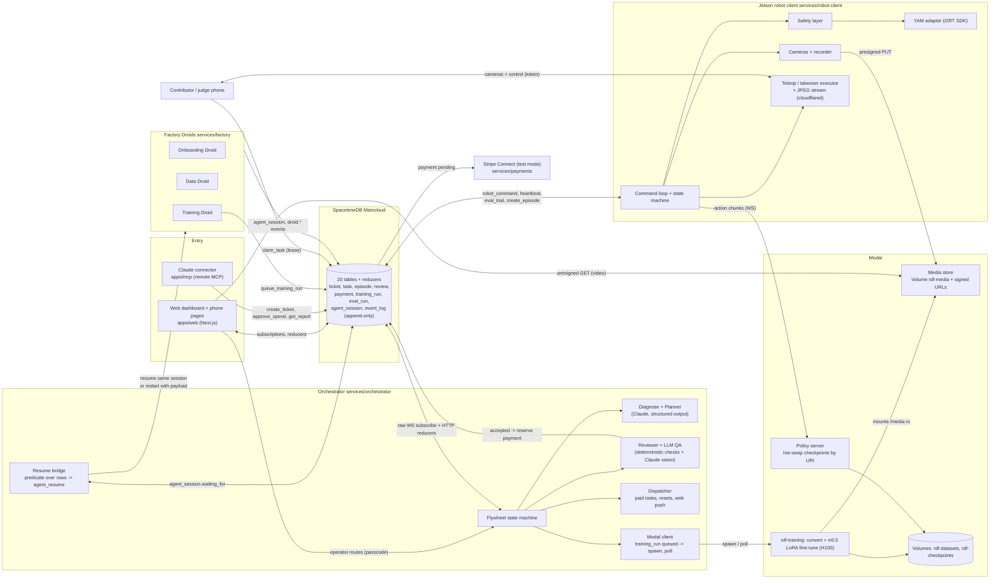

# Architecture overview

A concise map of the components that exist in this repo and how data flows between them. Details and the reasons behind each choice are in `docs/decisions.md`; the build spec is `CONTEXT.md`.

## Diagram



## Components

| Component | Path | What it does |
|---|---|---|
| SpacetimeDB module | `spacetime/` | Schema (20 tables), reducers, auth allow-list. Enforces: one arm-control lease per robot (`claim_task`), budget caps on every payout, `approve_spend`, service-only `append_event` with no update or delete path. Maincloud database `robo-factory-a706j`. |
| Web | `apps/web/` | Ticket pages (`/tickets/new`, `/tickets/[id]`, `/report`, `/spend`), `/agents`, `/events` (chain-hash seal), `/marketplace`, `/join` (QR + push opt-in), `/teleop/[taskId]`, `/reset/[taskId]`, `/robots/[id]` (operator console, soft e-stop), `/earnings`, `/sell/[offerId]`, `/ops/login`. Live via SpacetimeDB subscriptions. |
| Claude connector | `apps/mcp/` | Streamable-HTTP MCP server: `create_ticket`, `ticket_status`, `approve_spend`, `get_report`, `list_robots`. Approvals call the reducer as the `mcp` identity and are logged as `human:via_mcp`. |
| Orchestrator | `services/orchestrator/` | FastAPI app with a raw-WebSocket SpacetimeDB subscriber. Handlers: flywheel, diagnose (failure clustering), planner (recovery vs clean), dispatcher (tasks, resets, Web Push paging), reviewer, dataset QA + LLM QA, dataset offers, eval orchestration (Wilson CI, finalizer), interventions (DAgger pause/takeover routing), Modal client, resume bridge, report and decision-trail APIs, media signing, stream tokens. |
| Factory client + Droids | `services/factory/` | `FactoryClient` (local `droid-sdk` or Factory Sessions API) mirrors every session into `agent_session` and `event_log`. Droid roles: onboarding, data, training. Bounds: `autonomy=off`, one allow-listed tool, `write_roots`, `max_turns`. Droid contract: end a turn with `DONE` or `WAITING_FOR <predicate>`. |
| Robot client | `services/robot-client/` | Runs on the Jetson. Command loop and state machine, `ArmAdapter` interface with `SimArm` and `YamArm`, safety layer, cameras (top + wrist, synced), recorder (H.264 + `actions.parquet`), uploader, policy rollout (async chunks), eval trial runner, interventions, teleop executor, JPEG WebSocket stream behind a cloudflared quick tunnel, control-lease guard, onboarding checks. |
| Training | `services/training/` | Modal app `rdf-training`: LeRobot v2.1 conversion, π0.5 LoRA fine-tune (1x H100, 2 h cap), `Policy` server (LRU of 2 checkpoints, bearer auth, scale to zero), checkpoint registry and GPU cost estimate, Data Droid dataset tools. |
| Media store | `services/media-store/` | Modal Volume `rdf-media` behind a signed-URL app. Keys `tickets/{t}/episodes/{e}/{file}`; URIs `modal-vol://rdf-media/<key>`. |
| Payments | `services/payments/` | Stripe Connect test mode: connected accounts, idempotent transfers after an accepted review, webhook signature check. |
| Common | `services/common/`, `packages/` | Env loaders, episode format, review checks, SpacetimeDB bindings and clients. |
| Harness | `tests/integration/`, `make test-loop` | Throwaway local SpacetimeDB, fake robot, fake contributor, stub trainer; scripted or real-orchestrator driver. |

## Data flow for one ticket

1. `create_ticket` (web form or MCP; Claude parses the prompt into a structured work order). The flywheel moves the ticket through `onboarding` (Onboarding Droid, opt-in) to `baseline`.
2. The orchestrator issues `run_baseline` as a `robot_command`. The Jetson runs N trials: home, record, policy rollout against the policy server, operator-confirmed outcome, upload the episode (presigned PUT), `record_eval_trial`, then wait for `resume_policy`. Resets between trials are paid tasks.
3. On the finalized baseline eval, diagnose clusters the failed trials (notes, durations, sampled frames) and writes `failure_cluster` rows plus one `diagnose.clusters` event.
4. The planner writes a `data_plan` (`recovery_takeover` or `clean_teleop`, amount, verbatim reasoning). A human calls `approve_spend` (dashboard or MCP). Optionally the planner suggests buying an existing dataset instead; the offer flow reserves slots inside the approved cents.
5. The dispatcher creates tasks and pages contributors (Web Push). A phone claims one (atomic lease), gets a camera and control token scoped to that task, drives the arm through the teleop executor, and the recorder writes the episode with takeover and handback marks. For recovery, the robot pauses on a detected failure and the orchestrator routes a takeover task first.
6. The reviewer runs deterministic checks and a Claude vision judgement, writes `review`, and an accepted episode reserves a payment; the Stripe handler transfers it (test mode).
7. The Data Droid (opt-in) assembles the LeRobot dataset from accepted episodes only. The Training Droid (opt-in) sanity-checks it, writes justified hyperparameters and calls `queue_training_run`; otherwise the flywheel queues the run directly. The Modal client spawns convert then finetune and polls until `done` with a checkpoint URI and a GPU cost.
8. Eval runs the same trial runner on the new checkpoint. The finalizer computes the success rate and Wilson interval; the ship step marks the checkpoint deployed, activates it on the policy server and saves the report.
9. Throughout, every actor writes to `event_log` through one path; the `/events` page shows the chain-hash seal, and `GET /tickets/{id}/decision` joins the whole chain by id.

## The resume bridge

```
droid turn ends: "WAITING_FOR dataset:accepted_count>=5 timeout=2h"
  -> FactoryClient parses it -> agent_wait_for(session, predicate, resume_payload)
  -> orchestrator resume bridge stores the predicate (ticket-scoped)
  -> on every row change of the named table (and a 30 s safety poll) it re-evaluates
  -> true: agent_resume(session) is the atomic claim (one bridge wins)
  -> FactoryClient.resume: POST a message to the SAME Factory session (protocol A)
     or, if the session is gone, start a new one seeded with resume_payload (protocol B)
  -> the droid's next turn gets: predicate, what changed, matched rows, payload, ticket snapshot
  -> a wait that stays false past its deadline is woken with "TIMED OUT" instead
```

Live proof (local droid, throwaway SpacetimeDB): a `submit_review(accepted)` woke a parked data droid in 597 ms on the same session, 2 turns, 5,168 credits. The Training Droid proof chained two waits on one session (queue, OOM retry, done) in 3 turns.

## What is real as of this draft, and what is not

| Area | Status |
|---|---|
| SpacetimeDB module, reducers, event log, Maincloud | Real, published. |
| Orchestrator flywheel, planner, clustering, reviewer, dispatcher, eval stats, resume bridge | Real; proofs on throwaway local databases with labelled fixtures and the fake robot. |
| Factory Droids (3 roles) | Real sessions via local `droid-sdk`. Cloud Sessions API implemented, unit-tested, not proven live. |
| Fine-tune and policy server | Real on H100 via ephemeral `modal run`; the deployed app still needs `make deploy-modal`. |
| YAM adapter, safety limits | Built on the I2RT SDK; run only in its MuJoCo simulator. Limits unverified on the arm. |
| Teleop, recording, interventions | Proven on the simulated arm with synthetic cameras. |
| Camera stream | Measured laptop to laptop through the tunnel (p50 38-40 ms); not yet from the Jetson. |
| Stripe | Test mode; one real test transfer pending the Connect liability acknowledgement. |
| Real-arm baseline and after evals | `[TODO after real run]` |
